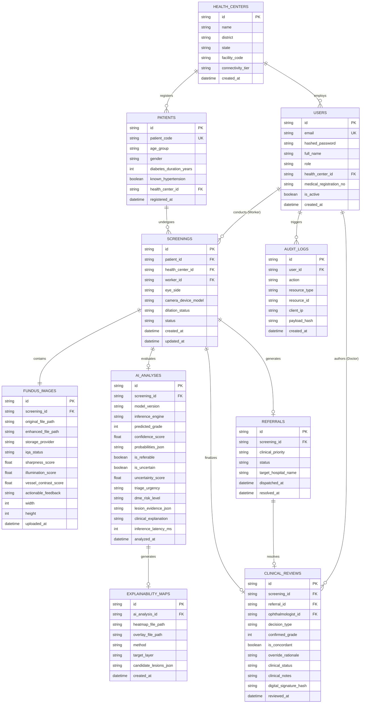

# RetinaSahayak: Database Schema & Entity Architecture

**Problem Statement ID:** SIH26038 | **ORM:** SQLAlchemy 2.0 (Declarative Base)  
**Database Engines:** SQLite 3 (WAL Mode for Local Prototype) / Cloud SQL PostgreSQL 15+ / Firestore Compatible  
**Privacy Standard:** Zero Direct PII (No real names, phone numbers, Aadhaar, or biometric identifiers collected)

---

## 1. Entity-Relationship Diagram (Mermaid)

---

## 2. Table Specifications & Fields

### 2.1 `health_centers`
- `id` (`VARCHAR(36)`, PK): e.g., `hc_ramnagar_01`
- `name` (`VARCHAR(128)`, NOT NULL): e.g., "Ramnagar Primary Health Centre"
- `district` (`VARCHAR(64)`, NOT NULL): e.g., "Varanasi"
- `state` (`VARCHAR(64)`, NOT NULL): e.g., "Uttar Pradesh"
- `facility_code` (`VARCHAR(32)`, UNIQUE, NOT NULL): National HFR facility code
- `connectivity_tier` (`VARCHAR(16)`, DEFAULT `'TIER_3'`): `'TIER_1'` (High-speed fiber), `'TIER_2'` (4G), `'TIER_3'` (Intermittent 2G/Offline)
- `created_at` (`DATETIME`, DEFAULT `CURRENT_TIMESTAMP`)

---

### 2.2 `users`
- `id` (`VARCHAR(36)`, PK): e.g., `usr_9b1deb4d`
- `email` (`VARCHAR(128)`, UNIQUE, NOT NULL, INDEX)
- `hashed_password` (`VARCHAR(255)`, NOT NULL): bcrypt hash
- `full_name` (`VARCHAR(100)`, NOT NULL): Health worker / doctor title and name
- `role` (`VARCHAR(20)`, NOT NULL): Enum: `'PHC_WORKER'`, `'OPHTHALMOLOGIST'`, `'ADMIN'`
- `health_center_id` (`VARCHAR(36)`, FK $\rightarrow$ `health_centers.id`, NULLABLE)
- `medical_registration_no` (`VARCHAR(64)`, NULLABLE): Doctor state medical council registration ID
- `is_active` (`BOOLEAN`, DEFAULT `TRUE`)
- `created_at` (`DATETIME`, DEFAULT `CURRENT_TIMESTAMP`)

---

### 2.3 `patients` (Anonymized — Zero Direct PII)
- `id` (`VARCHAR(36)`, PK): e.g., `pat_8841c9`
- `patient_code` (`VARCHAR(32)`, UNIQUE, NOT NULL, INDEX): Anonymized code, e.g., `PAT-VNS-8841`
- `age_group` (`VARCHAR(16)`, NOT NULL): Enum: `'18-35'`, `'36-50'`, `'51-65'`, `'65+'`
- `gender` (`VARCHAR(10)`, NOT NULL): Enum: `'MALE'`, `'FEMALE'`, `'OTHER'`
- `diabetes_duration_years` (`INTEGER`, NOT NULL, DEFAULT `0`)
- `known_hypertension` (`BOOLEAN`, NOT NULL, DEFAULT `FALSE`)
- `health_center_id` (`VARCHAR(36)`, FK $\rightarrow$ `health_centers.id`, NOT NULL)
- `registered_at` (`DATETIME`, DEFAULT `CURRENT_TIMESTAMP`)

---

### 2.4 `screenings`
- `id` (`VARCHAR(36)`, PK): e.g., `scr_22a7f8`
- `patient_id` (`VARCHAR(36)`, FK $\rightarrow$ `patients.id`, NOT NULL, INDEX)
- `health_center_id` (`VARCHAR(36)`, FK $\rightarrow$ `health_centers.id`, NOT NULL)
- `worker_id` (`VARCHAR(36)`, FK $\rightarrow$ `users.id`, NOT NULL)
- `eye_side` (`VARCHAR(2)`, NOT NULL): `'OD'` (Right Eye), `'OS'` (Left Eye)
- `camera_device_model` (`VARCHAR(64)`, NOT NULL): e.g., "Forus 3nethra Classic"
- `dilation_status` (`VARCHAR(16)`, NOT NULL, DEFAULT `'UNDILATED'`): `'DILATED'`, `'UNDILATED'`
- `status` (`VARCHAR(32)`, NOT NULL, DEFAULT `'INITIALIZED'`): `'INITIALIZED'`, `'IMAGE_UPLOADED'`, `'IQA_REJECTED'`, `'AI_ANALYZED'`, `'REFERRAL_DISPATCHED'`, `'VERIFIED_BY_DOCTOR'`, `'CLOSED'`
- `created_at` (`DATETIME`, DEFAULT `CURRENT_TIMESTAMP`, INDEX)
- `updated_at` (`DATETIME`, DEFAULT `CURRENT_TIMESTAMP`)

---

### 2.5 `fundus_images`
- `id` (`VARCHAR(36)`, PK): e.g., `img_aa7109`
- `screening_id` (`VARCHAR(36)`, FK $\rightarrow$ `screenings.id`, UNIQUE, NOT NULL)
- `original_file_path` (`VARCHAR(255)`, NOT NULL): Storage path on disk or GCS bucket object URI
- `enhanced_file_path` (`VARCHAR(255)`, NULLABLE): Storage path to CLAHE/Ben Graham enhanced asset
- `storage_provider` (`VARCHAR(32)`, NOT NULL, DEFAULT `'LOCAL_STORAGE_PROVIDER'`): `'LOCAL_STORAGE_PROVIDER'` or `'GCS_STORAGE_PROVIDER'`
- `iqa_status` (`VARCHAR(16)`, NOT NULL): Enum: `'GOOD'`, `'BORDERLINE'`, `'REJECT'`
- `sharpness_score` (`FLOAT`, NOT NULL): Laplacian variance ($\sigma^2$)
- `illumination_score` (`FLOAT`, NOT NULL): Mean luminance
- `vessel_contrast_score` (`FLOAT`, NOT NULL): Green-channel vascular gradient
- `actionable_feedback` (`TEXT`, NULLABLE): Human-readable recapture instructions
- `width` (`INTEGER`, NOT NULL)
- `height` (`INTEGER`, NOT NULL)
- `uploaded_at` (`DATETIME`, DEFAULT `CURRENT_TIMESTAMP`)

---

### 2.6 `ai_analyses`
- `id` (`VARCHAR(36)`, PK): e.g., `ana_44b910`
- `screening_id` (`VARCHAR(36)`, FK $\rightarrow$ `screenings.id`, UNIQUE, NOT NULL)
- `model_version` (`VARCHAR(64)`, NOT NULL): e.g., `RetinaSahayak-EfficientNet-v2.1`
- `inference_engine` (`VARCHAR(32)`, NOT NULL): `'PYTORCH_EFFICIENTNET'` or `'MOCK_INFERENCE_SERVICE'`
- `predicted_grade` (`INTEGER`, NOT NULL): $0$ to $4$
- `confidence_score` (`FLOAT`, NOT NULL): Probability of predicted class ($0.0 - 1.0$)
- `probabilities_json` (`TEXT`, NOT NULL): JSON object with 5-class distribution
- `is_referable` (`BOOLEAN`, NOT NULL, INDEX): True if Grade $\ge 2$
- `is_uncertain` (`BOOLEAN`, NOT NULL, INDEX): True if confidence $< 0.65$ or high entropy
- `uncertainty_score` (`FLOAT`, NOT NULL): Normalized Shannon entropy ($0.0 - 1.0$)
- `triage_urgency` (`VARCHAR(16)`, NOT NULL): `'HEALTHY'`, `'MONITOR'`, `'ROUTINE'`, `'URGENT'`, `'EMERGENCY'`
- `dme_risk_level` (`VARCHAR(16)`, NOT NULL): `'NONE'`, `'MILD'`, `'MODERATE'`, `'SEVERE'`
- `lesion_evidence_json` (`TEXT`, NOT NULL): JSON dictionary of detected lesions & quadrants
- `clinical_explanation` (`TEXT`, NOT NULL): Plain-language justification string
- `inference_latency_ms` (`INTEGER`, NOT NULL)
- `analyzed_at` (`DATETIME`, DEFAULT `CURRENT_TIMESTAMP`)

---

### 2.7 `explainability_maps`
- `id` (`VARCHAR(36)`, PK): e.g., `xai_19c4d2`
- `ai_analysis_id` (`VARCHAR(36)`, FK $\rightarrow$ `ai_analyses.id`, UNIQUE, NOT NULL)
- `heatmap_file_path` (`VARCHAR(255)`, NOT NULL): Colormap image path
- `overlay_file_path` (`VARCHAR(255)`, NOT NULL): Blended fundus overlay image path
- `method` (`VARCHAR(32)`, NOT NULL, DEFAULT `'Grad-CAM++'`)
- `target_layer` (`VARCHAR(64)`, NOT NULL, DEFAULT `'model.features.7'`)
- `candidate_lesions_json` (`TEXT`, NOT NULL): Bounding box coordinates $[x, y, w, h]$ of peak activation zones
- `created_at` (`DATETIME`, DEFAULT `CURRENT_TIMESTAMP`)

---

### 2.8 `referrals`
- `id` (`VARCHAR(36)`, PK): e.g., `ref_91b402`
- `screening_id` (`VARCHAR(36)`, FK $\rightarrow$ `screenings.id`, UNIQUE, NOT NULL)
- `clinical_priority` (`VARCHAR(20)`, NOT NULL, INDEX): `'EMERGENCY'`, `'URGENT'`, `'ROUTINE'`, `'UNCERTAIN_REVIEW'`
- `status` (`VARCHAR(20)`, NOT NULL, DEFAULT `'PENDING'`, INDEX): `'PENDING'`, `'IN_REVIEW'`, `'VERIFIED'`, `'CLOSED'`
- `target_hospital_name` (`VARCHAR(128)`, NOT NULL): e.g., "BHU Eye Hospital"
- `dispatched_at` (`DATETIME`, DEFAULT `CURRENT_TIMESTAMP`)
- `resolved_at` (`DATETIME`, NULLABLE)

---

### 2.9 `clinical_reviews`
- `id` (`VARCHAR(36)`, PK): e.g., `rev_7718e2`
- `screening_id` (`VARCHAR(36)`, FK $\rightarrow$ `screenings.id`, UNIQUE, NOT NULL)
- `referral_id` (`VARCHAR(36)`, FK $\rightarrow$ `referrals.id`, NULLABLE)
- `ophthalmologist_id` (`VARCHAR(36)`, FK $\rightarrow$ `users.id`, NOT NULL)
- `decision_type` (`VARCHAR(32)`, NOT NULL): `'AGREE_WITH_AI'`, `'MODIFY_GRADE'`, `'MARK_NON_REFERABLE'`, `'MARK_REFERABLE'`, `'REQUEST_REPEAT_IMAGING'`, `'MARK_FOLLOW_UP_REQUIRED'`, `'CLOSE_CASE'`
- `confirmed_grade` (`INTEGER`, NOT NULL): $0$ to $4$
- `is_concordant` (`BOOLEAN`, NOT NULL): True if doctor agreed with AI grade
- `override_rationale` (`TEXT`, NULLABLE): Mandatory reason if grade was modified
- `clinical_status` (`VARCHAR(32)`, NOT NULL): `'FOLLOW_UP_REQUIRED'`, `'REFERRED_TERTIARY'`, `'CASE_CLOSED'`
- `clinical_notes` (`TEXT`, NOT NULL): Clinical observations and prescriptions
- `digital_signature_hash` (`VARCHAR(128)`, NOT NULL): SHA-256 seal of the diagnosis
- `reviewed_at` (`DATETIME`, DEFAULT `CURRENT_TIMESTAMP`)

---

### 2.10 `audit_logs`
- `id` (`VARCHAR(36)`, PK): e.g., `aud_0019fa`
- `user_id` (`VARCHAR(36)`, FK $\rightarrow$ `users.id`, NULLABLE)
- `action` (`VARCHAR(64)`, NOT NULL, INDEX): `'LOGIN'`, `'VIEW_PATIENT'`, `'UPLOAD_FUNDUS'`, `'RUN_AI'`, `'DOCTOR_SIGN_OFF'`
- `resource_type` (`VARCHAR(32)`, NOT NULL)
- `resource_id` (`VARCHAR(36)`, NOT NULL)
- `client_ip` (`VARCHAR(45)`, NOT NULL)
- `payload_hash` (`VARCHAR(64)`, NOT NULL): SHA-256 hash of operation
- `created_at` (`DATETIME`, DEFAULT `CURRENT_TIMESTAMP`, INDEX)

---

## 3. Seed Demo Data Specifications

Upon initial execution, the seeder automatically provisions:
1. **5 Users:**
   - 1 Admin (`admin@retinasahayak.in`)
   - 2 Health Workers (`worker.ramnagar@retinasahayak.in`, `worker.chiraigaon@retinasahayak.in`)
   - 2 Ophthalmologists (`dr.verma@retinasahayak.in`, `dr.sharma@retinasahayak.in`)
2. **2 Health Facilities:** Ramnagar PHC and Chiraigaon CHC.
3. **10 Anonymized Patients:** With diverse age groups, diabetes histories, and linked fundus screenings across all 5 ICDR grades and quality rejection states.
