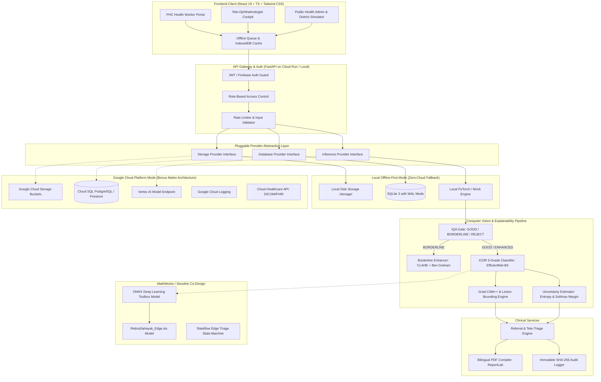

# RetinaSahayak: Master Implementation Plan

**Problem Statement ID:** SIH26038  
**Title:** Explainable AI for Diabetic Retinopathy Screening in Rural India  
**Theme:** MedTech / BioTech / HealthTech  
**Sponsor:** MathWorks | **Category:** Software  
**Target Event:** Smart India Hackathon 2026  
**Clinical Scope:** Clinical Decision Support System (CDSS) — Human-in-the-Loop Screening Triage  
**Cloud & Edge Architecture:** Dual-Mode Architecture (Local Offline-First + Google Cloud Platform Hybrid)

---

## 1. Executive Summary & Problem Context

Diabetic Retinopathy (DR) is the primary cause of preventable blindness in India, affecting over 18% of the country’s 77+ million diabetic population. In rural India, where 70% of diabetics reside, Primary Health Centres (PHCs) lack trained ophthalmologists and expensive diagnostic equipment. By the time rural patients travel to tertiary eye hospitals, the disease has often progressed to irreversible stages: Severe NPDR or Proliferative Diabetic Retinopathy (PDR) with Diabetic Macular Edema (DME).

**RetinaSahayak** solves this challenge through an explainable, quality-aware, offline-first AI screening platform designed for rural health workers (ASHAs/ANMs) and tele-ophthalmologists:
1. **Quality-Aware Ingestion:** Retinal fundus images are evaluated via an automated Image Quality Assessment (IQA) gate into **GOOD**, **BORDERLINE**, or **REJECT** before AI grading. Borderline images undergo automated CLAHE and illumination enhancement.
2. **Deep Learning ICDR Grading:** Classifies images into **Grade 0 to Grade 4** according to the International Clinical Diabetic Retinopathy standard, with calibrated confidence and uncertainty estimation.
3. **Transparent Explainability (XAI):** Generates Grad-CAM/Grad-CAM++ heatmaps, blends perceptual overlays, identifies candidate lesion clusters (microaneurysms, hemorrhages, exudates), and constructs plain-language clinical rationales.
4. **Bilingual Medical Reports:** Compiles high-resolution, vernacular (English + Hindi) 2-page PDF reports complete with patient guidance and tele-consultation QR codes.
5. **Human-in-the-Loop Triage:** Referable (Grade 2–4) or uncertain predictions route automatically to an asynchronous Tele-Ophthalmology Cockpit for specialist validation and digital sign-off.
6. **Dual-Mode Cloud/Local Infrastructure:** Fully functional local offline-first mode (SQLite + Local File Storage + PyTorch/Mock ML) with seamless pluggable provider abstraction for **Google Cloud Platform (GCS, Firestore/Cloud SQL, Cloud Run, Vertex AI, Healthcare API)**.
7. **MathWorks & District-Scale Simulation:** Complete MathWorks Simulink edge deployment specification (`RetinaSahayak_Edge.slx`) and a web-based simulation engine modeling 100,000+ rural diabetic patients across district PHC networks.

### Human-in-the-Loop Medical Disclaimer
> **MANDATORY CLINICAL BOUNDARY:** RetinaSahayak is an auxiliary screening-support and tele-triage tool, **not** an autonomous medical diagnostic device. It never claims to replace an ophthalmologist. All AI findings represent *"Presumptive Screening Observations"* and must be validated by a certified ophthalmologist before any clinical or surgical treatment is initiated.

---

## 2. Complete System Architecture & Dual-Mode Strategy

---

## 3. End-to-End Clinical Data Flow

### Step 1: Anonymized Patient Registration (Zero PII Compliance)
- Health worker registers the patient without storing direct PII (no real names, phone numbers, or Aadhaar numbers).
- Fields captured: Anonymized Patient Code (`PAT-XXXX`), Age Group (`18-35`, `36-50`, `51-65`, `65+`), Sex (`MALE`, `FEMALE`, `OTHER`), Diabetes Duration in years, Known Hypertension (`YES`/`NO`), and Originating PHC Name.
- If offline, entry is cached in the browser `IndexedDB` upload queue.

### Step 2: Retinal Fundus Capture & Local Pre-Validation
- Fundus photo uploaded (JPG, PNG, or TIFF, minimum resolution $800 \times 800$, max $15\text{MB}$).
- Client checks file integrity and image aspect ratio.

### Step 3: Multi-Criteria Image Quality Assessment (IQA Gate)
Before invoking deep learning grading, the image passes through the deterministic IQA engine:
- **Criteria Evaluated:**
  1. Focus & Sharpness: Laplacian variance $\text{Var}(\nabla^2 I) \ge 100$.
  2. Illumination Balance: Mean luminance within $[28, 230]$ and overexposure saturation $< 15\%$.
  3. Vessel Visibility & Contrast: Green-channel vascular gradient $\ge 0.35$.
- **Triage Decisions:**
  - **`REJECT`:** Fails critical sharpness or exposure. DR grading is aborted. Actionable guidance returned (e.g., *"Image too dark: increase illumination dial and recapture"*).
  - **`BORDERLINE`:** Sub-optimal contrast or mild illumination gradient. Enhanced automatically via Green CLAHE and Ben Graham contrast normalization. Both original and enhanced images are retained.
  - **`GOOD`:** Optimal diagnostic quality. Advances directly to grading.

### Step 4: Diabetic Retinopathy Grading & Uncertainty Scoring
- Image is passed into the PyTorch EfficientNet-B4 backbone (or calibrated Mock Inference engine if weights are not local).
- Produces softmax probabilities across:
  - **Grade 0:** No Apparent DR (Non-Referable)
  - **Grade 1:** Mild NPDR (Non-Referable)
  - **Grade 2:** Moderate NPDR (Referable)
  - **Grade 3:** Severe NPDR (Referable)
  - **Grade 4:** Proliferative DR - PDR (Referable / Emergency)
- **Uncertainty & Referral Rules:**
  - If $\max(P) < 0.65$ or entropy is high, case is marked **`UNCERTAIN`** and automatically routed for tele-ophthalmologist review regardless of predicted grade.
  - Grade 0 and Grade 1 $\rightarrow$ `NON-REFERABLE` (unless uncertain).
  - Grade 2, 3, and 4 $\rightarrow$ `REFERABLE`.

### Step 5: Explainability Engine (Grad-CAM++ & Lesion Localization)
- Computes second-order partial gradients on the final convolutional layer.
- Generates a $512 \times 512$ activation heatmap and blends a 40% alpha overlay with the fundus photograph.
- Extracts candidate lesion clusters (microaneurysms, hemorrhages, hard exudates) and flags macular proximity.
- Generates plain-language medical rationale explaining why the grade was predicted.

### Step 6: Bilingual Medical PDF Report Generation
- ReportLab compiles a 2-page A4 PDF report with:
  - Anonymized patient ID, PHC location, and date.
  - Original and enhanced fundus photos alongside Grad-CAM++ overlays.
  - IQA score, predicted grade, confidence, and uncertainty status.
  - Regional language summary (Hindi vernacular text + pictorial icons).
  - Tele-consultation verification QR code and CDSS disclaimer.

### Step 7: Tele-Ophthalmology Cockpit & Specialist Sign-Off
- Referable or uncertain cases populate the Ophthalmologist's prioritized triage queue.
- Specialist views side-by-side original/enhanced images, zooms into suspicious quadrants, and adjusts the Grad-CAM opacity slider.
- Specialist confirms the grade or overrides with clinical justification, prescribes treatment, and signs off.
- Action is written to an immutable audit log with a SHA-256 digital signature hash.

### Step 8: Public Health Analytics & 100k District Simulation
- Admin monitors district-level prevalence, IQA rejection trends, and AI-Doctor concordance.
- Admin accesses the interactive Google Cloud District Simulation to stress-test screening capacity, network bandwidth, and ophthalmologist workloads across 100,000+ rural patients.

---

## 4. Judging Criteria Optimization Matrix

| Hackathon Criterion | Weight | RetinaSahayak Implementation Strategy |
| :--- | :---: | :--- |
| **1. Functionality** | **40%** | Complete end-to-end working loop: Auth $\rightarrow$ Anonymized Patient $\rightarrow$ Image Upload $\rightarrow$ IQA (Good/Borderline/Reject) $\rightarrow$ DR Grade $\rightarrow$ Grad-CAM++ $\rightarrow$ PDF Report $\rightarrow$ Referral $\rightarrow$ Doctor Review $\rightarrow$ Admin Analytics. No fake non-working buttons. |
| **2. User Experience** | **20%** | Ultra-simple 3-step wizard for rural health workers. Large touch-friendly controls, Green/Yellow/Red traffic-light cues, zero medical jargon on intake screens, responsive mobile/tablet layout, offline indicators. |
| **3. Technical Complexity** | **20%** | Real PyTorch ML pipeline + deterministic mock fallback, Grad-CAM++ mathematical hooks, pluggable provider abstraction (Local vs Google Cloud), Cloud Run Docker setup, JWT RBAC, and FHIR/DICOM interoperability layer. |
| **4. Innovation** | **10%** | Quality-aware pre-screening gate, uncertainty-aware triage, bilingual vernacular PDF with QR verification, and a 100,000-patient rural district deployment simulation. |
| **5. Presentation** | **10%** | 6-slide executive deck, 12-slide comprehensive presentation, 5-minute judge demo script, 3-minute 4-speaker pitch script, Judge Q&A cheat sheet, and MathWorks Simulink specifications. |

---

## 5. Implementation Roadmap & Milestones

- **Phase 0:** Master Architecture, Planning Artifacts & Review (COMPLETE).
- **Phase 1:** Project Scaffolding, Backend Core, Auth, Database & Storage Abstraction.
- **Phase 2:** Computer Vision, IQA Gate, Image Enhancement & ML Pipeline.
- **Phase 3:** Grad-CAM++ Explainability & Lesion Evidence Engine.
- **Phase 4:** Tele-Ophthalmology Cockpit, Referral Triage & Audit System.
- **Phase 5:** Bilingual ReportLab PDF Generator.
- **Phase 6:** React + TypeScript + Tailwind Frontend (3 User Personas).
- **Phase 7:** Google Cloud Architecture Integration & District-Scale Simulation.
- **Phase 8:** MathWorks Simulink / Stateflow Model & ONNX Export.
- **Phase 9:** Golden Demo Dataset, Automated Tests, Documentation & Pitch Polish.
