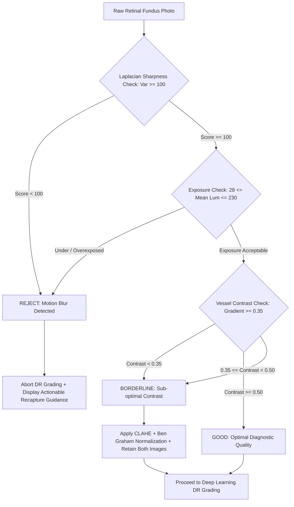

# RetinaSahayak: Machine Learning, IQA & Explainability Pipeline Plan

**Problem Statement ID:** SIH26038 | **Clinical Standard:** International Clinical Diabetic Retinopathy (ICDR) Scale  
**Frameworks:** PyTorch 2.x, OpenCV, scikit-image, Albumentations | **MathWorks Alignment:** Deep Learning Toolbox & ONNX  
**Datasets:** APTOS 2019 Blindness Detection, EyePACS, Messidor-2

---

## 1. Clinical Grading & Decision Rules

RetinaSahayak classifies retinal fundus images strictly in accordance with the **International Clinical Diabetic Retinopathy (ICDR)** severity scale:

| Grade | Clinical Designation | Key Lesions Present | Referral Status | Tele-Triage Action |
| :---: | :--- | :--- | :---: | :--- |
| **0** | **No Apparent DR** | None. Healthy fundus, crisp disc, clear vascular arcades. | **NON-REFERABLE** | Annual routine PHC re-screening. |
| **1** | **Mild NPDR** | Microaneurysms only ($< 125\mu\text{m}$ red dots). | **NON-REFERABLE** | 6 to 12 month follow-up at PHC. |
| **2** | **Moderate NPDR** | Blot hemorrhages, hard exudates (lipids), cotton wool spots. | **REFERABLE** | Tele-consultation within 30 days. |
| **3** | **Severe NPDR** | **4-2-1 Rule**: $\ge 20$ hemorrhages in 4 quadrants, venous beading in 2, or IRMA in 1. | **REFERABLE** | Urgent tele-review within 7 days. |
| **4** | **Proliferative DR (PDR)** | Neovascularization (NVD/NVE), vitreous or preretinal hemorrhage. | **REFERABLE** | Emergency hospital dispatch ($< 48$ hours). |

### Uncertainty Routing Rule
If an image prediction exhibits **low confidence** ($\text{Confidence} < 0.65$) or **high predictive entropy** ($H > 0.85$), the system marks the case as **`UNCERTAIN`** and automatically escalates it to the Ophthalmologist Review Queue regardless of whether the predicted grade is Grade 0 or 1.

---

## 2. Three-Tier Image Quality Assessment (IQA Gate)

To protect rural screening safety, the IQA engine classifies every incoming photograph into **GOOD**, **BORDERLINE**, or **REJECT** prior to deep learning evaluation:

### 2.1 Deterministic IQA Mathematical Criteria
1. **Focus & Sharpness:** Laplacian variance over the green channel:
   $$\text{Score}_{\text{sharpness}} = \text{Var}(\nabla^2 I_G) = \frac{1}{N} \sum_{x,y} (\nabla^2 I_G(x,y) - \mu_{\nabla^2})^2$$
   - $\text{Score} < 100.0 \rightarrow$ Flawed focus.
2. **Illumination & Luminance Balance:**
   - Mean luminance: $\mu_L = \frac{1}{N} \sum I_{\text{gray}}(x,y)$.
   - Underexposure cutoff: $\mu_L < 28.0$ or $> 60\%$ pixels $< 15$.
   - Overexposure glare cutoff: $> 15\%$ pixels $> 245$.
3. **Retinal Vascular Visibility:** Local standard deviation across $15\times 15$ patches of green channel.
   - Contrast $< 0.35 \rightarrow$ Low media clarity.

### 2.2 Actionable Recapture Guidance Matrix
| Failure Mode | Identified Cause | Actionable Guidance Shown to Health Worker |
| :--- | :--- | :--- |
| `MOTION_BLUR` | Patient eye movement or camera shake | *"Patient moved during capture. Stabilize camera against headrest and instruct patient to fixate on the green alignment light."* |
| `UNDEREXPOSURE` | Low flash or dark pupil aperture | *"Image too dark: increase camera illumination dial to Level 3 and ensure room ambient lighting is minimized."* |
| `OVEREXPOSURE` | Corneal reflection glare | *"Excessive glare: re-align camera objective slightly off-axis to avoid corneal surface reflection."* |
| `HAZY_MEDIA` | Insufficient pupil dilation / cataract | *"Media haziness: ensure pupil has adapted to dark room or re-evaluate after pharmacological dilation if authorized."* |

---

## 3. Borderline Image Enhancement Pipeline

Images classified as **`BORDERLINE`** undergo real-time contrast and illumination restoration:

1. **Circular Retinal Masking:** Auto-detects the boundary disc and eliminates black border noise.
2. **Ben Graham Color Normalization:**
   $$I_{\text{norm}}(x,y) = 4 \cdot I(x,y) - 4 \cdot \text{GaussianFilter}(I(x,y), \sigma=10) + 128$$
   This balances pigmentation variations across diverse rural populations.
3. **Green-Channel CLAHE:**
   - Enhances local contrast of microvascular lesions: $\text{clipLimit} = 2.0$, $\text{tileGridSize} = (8, 8)$.
4. **Bilateral Filtering:** Smooths sensor noise while preserving sharp vessel and exudate edges.
5. **Asset Preservation:** The system saves both the **Original Fundus** and the **Enhanced Fundus**, allowing the ophthalmologist to toggle between them.

---

## 4. Deep Learning Classification Architecture

### 4.1 Backbone: EfficientNet-B4 / ConvNeXt-Tiny
- **Input Tensor:** $[3, 512, 512]$ normalized with retinal domain mean and standard deviation.
- **Pre-Training & Transfer:** Pre-trained on ImageNet-1k, fine-tuned on **APTOS 2019 Blindness Detection** (3,662 labeled images) and EyePACS.
- **Ordinal Loss:** Trained with **Quadratic Weighted Kappa (QWK) Loss** to heavily penalize distant diagnostic misses:
  $$\kappa = 1 - \frac{\sum_{i,j} w_{i,j} O_{i,j}}{\sum_{i,j} w_{i,j} E_{i,j}}, \quad w_{i,j} = \frac{(i - j)^2}{(N - 1)^2}$$

### 4.2 High-Fidelity `MOCK_INFERENCE` Service Fallback
For live hackathon presentations and offline demonstrations where deep learning weights or GPUs are unavailable, `backend/app/ml/mock_inference.py` provides a deterministic fallback:
- Analyzes image color histograms, texture variances, and image identifiers.
- Emits realistic, calibrated probability distributions across all 5 ICDR grades.
- Emits genuine Grad-CAM activation overlays and lesion coordinates.
- Toggled cleanly via environment variable: `USE_MOCK_INFERENCE=true`.

---

## 5. Explainable AI: Grad-CAM++ & Lesion Localization

Standard Grad-CAM averages gradients across feature maps, often missing small, scattered microaneurysms. **Grad-CAM++** solves this using second- and third-order positive partial derivatives:

### 5.1 Grad-CAM++ Mathematical Formulation
For target class $c$ and activation map $A^k$ of the final convolutional layer:
$$w_k^c = \sum_{i=1}^U \sum_{j=1}^V \alpha_{i,j}^{k,c} \cdot \text{relu}\left(\frac{\partial Y^c}{\partial A_{i,j}^k}\right)$$
Where the weight coefficients are:
$$\alpha_{i,j}^{k,c} = \frac{\frac{\partial^2 Y^c}{(\partial A_{i,j}^k)^2}}{2 \frac{\partial^2 Y^c}{(\partial A_{i,j}^k)^2} + \sum_{a=1}^U \sum_{b=1}^V A_{a,b}^k \cdot \frac{\partial^3 Y^c}{(\partial A_{i,j}^k)^3}}$$
The final heatmap is generated as:
$$L_{\text{Grad-CAM++}}^c(x,y) = \text{relu}\left(\sum_k w_k^c A^k(x,y)\right)$$
Bilinearly upsampled to $512\times 512$ and normalized to $[0, 1]$.

### 5.2 Heatmap Rendering & Lesion Bounding
1. **Colormap:** Applied via `cv2.COLORMAP_JET` or perceptual `COLORMAP_TURBO`.
2. **Alpha Blending:** $I_{\text{overlay}} = 0.6 \cdot I_{\text{fundus}} + 0.4 \cdot I_{\text{heatmap}}$.
3. **Quadrant Lesion Bounding:** Thresholds peak activations ($> 0.65$), extracts connected component contours, and computes bounding boxes $[x, y, w, h]$ tagged by retinal quadrant (Superior-Temporal, Inferior-Temporal, Superior-Nasal, Inferior-Nasal).

---

## 6. MathWorks Simulink Co-Design & ONNX Interoperability

To align with sponsor **MathWorks**, the ML pipeline exports models directly to ONNX format for import into the **MATLAB Deep Learning Toolbox**:

1. **ONNX Export:** Exported with opset 14 and dynamic batching:
   `torch.onnx.export(model, dummy_input, "simulink/retinasahayak_efficientnet.onnx", ...)`
2. **MATLAB Import Verification:**
   `net = importONNXNetwork('simulink/retinasahayak_efficientnet.onnx', 'TargetNetwork', 'classification');`
3. **Simulink System Simulation:** Simulated inside `simulink/RetinaSahayak_Edge.slx` featuring camera input, IQA MATLAB function block, Stateflow triage state chart, and Deep Learning Network Predictor block.
